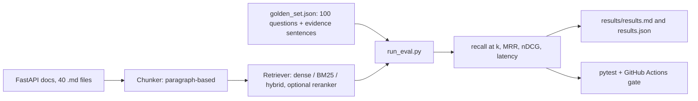

# Groundtruth: a retrieval evaluation harness

A small harness that answers one question: **did this retrieval change actually help?**
It scores a retriever on 100 questions over the FastAPI docs (recall@k, MRR, nDCG), compares 6 configurations, and fails a pull request in CI if recall@10 drops by more than one point.

**Headline result:** adding a cross-encoder reranker raised recall@10 from **0.87 to 0.93** and MRR from **0.51 to 0.71**, at a cost of about 650 ms per query on CPU (vs 12 ms without it).

## Results

Evaluated on the 90 answerable questions. Each config changes one thing from the baseline.

| Config | recall@5 | recall@10 | MRR | nDCG@10 | ms/query | words in top 10 |
|---|---|---|---|---|---|---|
| baseline (100w, dense) | 0.78 | 0.87 | 0.51 | 0.60 | 12 | 869 |
| bigger chunks (300w, dense) | 0.77 | 0.84 | 0.67 | 0.70 | 12 | 2450 |
| keyword only (100w, bm25) | 0.61 | 0.72 | 0.48 | 0.53 | 1 | 882 |
| hybrid (100w) | 0.77 | 0.84 | 0.56 | 0.61 | 15 | 884 |
| **dense + reranker (100w)** | **0.89** | **0.93** | **0.71** | **0.76** | 657 | 879 |
| hybrid + reranker (100w) | 0.84 | 0.93 | 0.69 | 0.74 | 663 | 892 |

recall@10 by question category:

| Config | simple | keyword | vague | multi_doc |
|---|---|---|---|---|
| baseline (100w, dense) | 0.83 | 1.00 | 0.76 | 0.90 |
| bigger chunks (300w, dense) | 0.90 | 0.92 | 0.72 | 0.80 |
| keyword only (100w, bm25) | 0.73 | 0.80 | 0.68 | 0.55 |
| hybrid (100w) | 0.87 | 0.96 | 0.72 | 0.75 |
| dense + reranker (100w) | 0.93 | 1.00 | 0.84 | 0.95 |
| hybrid + reranker (100w) | 0.93 | 1.00 | 0.88 | 0.90 |

Question by question against the baseline (recall@10): dense + reranker improved **7** questions, hurt **1**, left **82** unchanged.

## Recommendation

**Ship dense retrieval (all-MiniLM-L6-v2) on 100-word paragraph chunks, with a cross-encoder reranker (ms-marco-MiniLM-L-6-v2) over the top 20.**

- **Why:** the biggest and most consistent gain of everything I tried (+6 points recall@10, +20 points MRR).
- **Tradeoff:** about 650 ms per query on CPU, 50x slower than plain dense search. Fine for a research assistant, too slow for autocomplete.
- **Not recommended on this corpus:** hybrid search (no recall gain) and 300-word chunks (better ranking, no recall gain, 2.8x more text sent to the LLM).

## CI gate

`tests/test_regression.py` re-runs the shipped config on every pull request and fails if recall@10 falls more than 0.01 below the saved baseline (0.9278).

Demo: a pull request that switched to keyword-only search dropped recall@10 to 0.717 and was blocked.


With 90 questions, one question is about 1.1 points of recall@10, so the gate effectively fails if any single-evidence question gets worse.

## How it works



### The golden set
100 questions: 30 simple, 25 keyword, 25 vague, 10 multi-doc, 10 unanswerable. Each answerable question stores the **exact sentence that answers it**. A retrieved chunk counts as correct if it comes from the right file and contains that sentence, so the same labels work for any chunk size. `check_golden.py` verifies every evidence sentence exists in the docs.

The questions were drafted with an LLM (Claude) and then reviewed and edited by me. [EDIT: say how many you changed and what you fixed.] The 10 unanswerable questions are not used in the retrieval metrics.

### Design decisions
1. **Label by evidence sentence, not chunk id.** Chunk ids change with chunk size, sentences do not. Cost: a chunk that answers the question equally well, but without that exact sentence, counts as a miss.
2. **Chunk on paragraph breaks.** A sentence is never cut in half, and a test checks that every evidence sentence sits inside a chunk at both chunk sizes.
3. **One change per experiment.** Every config differs from the baseline in one setting, so a difference can be traced to its cause.
4. **Reranker pool of 20.** Chosen after the pool experiment below.

## What did not work
- **Hybrid search** (dense + BM25 with reciprocal rank fusion) gave no recall gain over dense: 0.84 vs 0.87. On question-by-question comparison it improved 3 questions and hurt 6. The keyword questions were already at 1.00 for dense.
- **300-word chunks** improved ranking (MRR 0.67 vs 0.51) but not recall (0.84 vs 0.87), and sent 2.8x more text.
- **A bigger reranker pool** (exploratory, chosen after seeing the failures, so treat with care): pool 20 / 50 / 100 gave recall@10 of 0.93 / 0.92 / 0.94 at 638 / 1509 / 2741 ms per query. No gain for up to 4.3x the latency.

## Where it still fails
For all 7 missed questions the right file was in the top 3. The misses are chunk-level. The causes below are my reading of the retrieved text.

| Question | What happened | Likely cause |
|---|---|---|
| q003: which HTTP methods send data | Right file (`body.md`), neighboring chunk. A `first-steps.md` chunk about HTTP methods ranked first. | Neighboring chunk, plus a competing chunk in another file |
| q059: stop extra values in the URL | Returned the "extra data gives an error" chunk, not the "restrict query parameters" sentence | The `header-`, `query-` and `form-` model docs say nearly the same thing; the returned chunk also arguably answers the question |
| q065: output does not match declared type | All top 3 from `response-model.md`, none the right chunk | A long file with many similar chunks |
| q076: what editor help do models give | Neighboring chunk of `body.md` ranked first; evidence chunk was dense rank 23 | Neighboring chunk |
| q086: organize files so tests can import the app | The only regression: the baseline found both evidence chunks, the reranker preferred another relevant `bigger-applications.md` chunk | The evidence sentence is generic, and the chunk returned instead is also relevant |

q010 and q066 follow the same patterns as q003 and q065.

## Limitations
- 90 answerable questions: one question is about 1.1 points overall (4 points in a 25-question category), so differences of 2-3 points are not conclusive.
- Strict evidence matching penalizes chunks that answer equally well from another place.
- One corpus (FastAPI tutorial docs), one embedding model, latency measured on a laptop CPU.
- The golden set was LLM-drafted, then reviewed by me.
- Not built yet: the generation layer (faithfulness and answer relevance of the final answers).

## Run it
```powershell
python -m venv venv
.\venv\Scripts\Activate.ps1
pip install -r requirements.txt

python src/check_golden.py        # check the golden set against the docs
python -m pytest tests -v         # unit tests + the regression gate
python -m src.run_eval            # run all 6 configs, writes results/
python -m src.analyze             # question-by-question comparison
python -m src.error_analysis      # inspect the failed questions
python -m src.pool_experiment     # reranker pool size experiment
```

## Layout
```
data/docs/            FastAPI tutorial docs (40 .md files)
data/golden_set.json  100 questions with evidence sentences
src/                  chunker, retriever, metrics, run_eval, analysis scripts
tests/                metrics tests, chunker coverage test, regression gate
results/              comparison tables, per-question results, baseline.json
.github/workflows/    CI
```

The documentation in `data/docs/` comes from the [FastAPI](https://github.com/fastapi/fastapi) project (MIT license).
