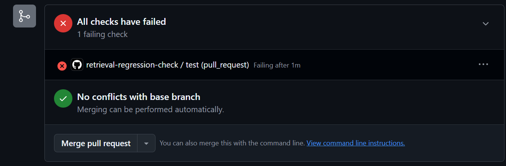
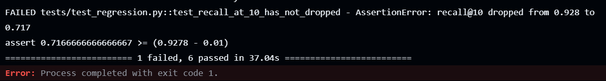
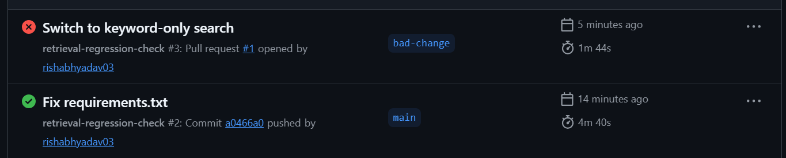

# Groundtruth

A small tool that checks whether a change to a retrieval system (the search part of RAG) really makes it better, using numbers instead of trying a few questions by hand.

I tested it on the FastAPI tutorial docs. The best setup I found was dense search plus a reranker. It raised recall@10 from 0.87 to 0.93 and MRR from 0.51 to 0.71, but a query takes about 600 ms on my laptop CPU instead of 33 ms. I also checked the final answers with a Groq model: 94% were correct, and most of the wrong ones came from retrieval.

Demo video (90 seconds): [ADD LINK]

## What is in the repo

- 40 FastAPI doc files used as the corpus
- 100 questions, each with the sentence that answers it
- recall@k, MRR and nDCG, written by hand and unit tested
- 7 retriever setups compared on the same questions
- confidence ranges, so I know which differences I can trust
- an answer-quality check using Groq
- a GitHub Action that fails a pull request if recall@10 drops by more than 1 point

## Results

Scored on the 90 questions that have an answer in the docs. Each setup changes one thing from the baseline.

| Setup | recall@5 | recall@10 | MRR | nDCG@10 | ms per query |
|---|---|---|---|---|---|
| baseline (100-word chunks, dense) | 0.78 | 0.87 | 0.51 | 0.60 | 33 |
| bigger chunks (300 words, dense) | 0.77 | 0.84 | 0.67 | 0.70 | 55 |
| keyword only (BM25) | 0.61 | 0.72 | 0.48 | 0.53 | 2 |
| hybrid (dense + BM25) | 0.77 | 0.84 | 0.56 | 0.61 | 73 |
| dense + reranker (MiniLM L6) | 0.89 | 0.93 | 0.71 | 0.76 | 773 |
| hybrid + reranker (MiniLM L6) | 0.84 | 0.93 | 0.69 | 0.74 | 869 |
| dense + reranker (MiniLM L4) | 0.86 | 0.93 | 0.71 | 0.76 | 599 |

Times come from one run on my laptop CPU. They change by 15 to 25 percent from run to run, so only compare numbers from the same table.

Compared with the baseline, question by question, dense + reranker (L6) got 7 questions better, 1 worse and 82 the same.

## How sure am I?

I only have 90 scored questions, so I resampled them 1,000 times to get 95% ranges. This shows the change compared with the baseline.

| Setup | recall@10 change | MRR change |
|---|---|---|
| bigger chunks | -0.02 (-0.10 to +0.06), not clear | +0.16 (+0.07 to +0.25), better |
| keyword only | -0.15 (-0.24 to -0.06), worse | -0.04 (-0.14 to +0.07), not clear |
| hybrid | -0.03 (-0.08 to +0.03), not clear | +0.04 (-0.03 to +0.11), not clear |
| dense + reranker (L6) | +0.06 (+0.02 to +0.11), better | +0.20 (+0.13 to +0.27), better |
| hybrid + reranker (L6) | +0.07 (+0.01 to +0.13), better | +0.18 (+0.10 to +0.26), better |
| dense + reranker (L4) | +0.07 (+0.02 to +0.12), better | +0.20 (+0.13 to +0.28), better |

"Not clear" means 90 questions cannot tell the setup apart from the baseline. These ranges are only a rough guide, because the questions were not picked at random, so the real uncertainty is a bit bigger. The reranker gain is real, but it could be as small as 2 points.

## What I would use

Dense search (all-MiniLM-L6-v2) on 100-word chunks, then a small cross-encoder reranker (MiniLM L4) on the top 20.

L4 gave the same recall@10, MRR and nDCG as the bigger L6 reranker. Its recall@5 is 3 points lower (0.86 vs 0.89) and it is about 20 to 30 percent faster. I chose it after seeing these results, so treat the choice as exploratory. In an earlier run an even smaller model (L2) was about 2.7 times faster than L6, but recall@10 fell to 0.89 and MRR to 0.68.

It is still much slower than plain dense search. If answers have to be instant, I would skip the reranker.

## What did not work

- Hybrid search did not beat plain dense search. recall@10 was 0.84 vs 0.87, and the ranges say I cannot tell them apart. It helped 3 questions and hurt 6.
- 300-word chunks ranked results better (MRR 0.67 vs 0.51) but recall@10 did not improve, and it sends almost 3 times more text.
- Letting the L6 reranker look at 50 or 100 chunks instead of 20 gave recall@10 of 0.92 and 0.94 (vs 0.93), and queries got 2 to 4 times slower. I tried this after looking at the failures, so take it with care.

## How the questions were made

There are 100 questions: 30 simple, 25 with exact keywords, 25 vaguely worded, 10 that need two files, and 10 that the docs cannot answer.

For every answerable question I saved the exact sentence from the docs that answers it. A retrieved chunk counts as correct if it comes from the right file and contains that sentence. This way the same questions work for any chunk size. A script checks that every sentence really exists in the docs.

[EDIT: say how you made the questions. For example: I used an LLM to draft them, then read all 100 and changed N of them.]

The 10 unanswerable questions are not used in the retrieval scores.

## The CI check

A test runs the shipped setup (dense + L4 reranker) on every pull request. It fails if recall@10 is more than 0.01 below the saved baseline (0.9333).

To test it I opened a pull request that switched to keyword-only search. recall@10 fell to 0.717 and the check blocked it.





## Answer quality (with Groq)

I also checked the final answers. For each question, the top 5 chunks go to an answering model (Qwen3.8 27B on Groq), which must answer only from them or say "I don't know". A different model (GPT-OSS 120B) judges each answer against a short reference answer and checks that it is supported by the chunks.

| | Result |
|---|---|
| Correct answers | 85/90 (94%) |
| Correct when the evidence was in the top 5 | 74/75 (99%) |
| Correct when the evidence was not in the top 5 | 11/15 (73%) |
| Wrong answers caused by retrieval / by generation | 4 / 1 |
| Answers supported by the chunks | 88/88 |
| "I don't know" on unanswerable questions | 10/10 |

Most of the weakness is in retrieval, not generation. And 11 of the 15 questions that my strict sentence rule counts as retrieval misses were still answered correctly, because another chunk had the answer. So the recall numbers above understate how useful the retrieval is.

Caveats:
- The judge is an LLM, and the reference answers are short ones drafted with an LLM. I read 15 judgments myself (all 5 wrong answers and 10 right ones) and agreed with [N]. One of them (q060) was debatable.
- Only 5 answers were wrong, so 4 vs 1 is a direction, not a firm split. The one "generation" failure was really an unclear question of mine.
- All 3 wrong answers that were not "I don't know" were still supported by the chunks, so being supported does not mean being correct.
- The unanswerable questions are far from the docs, so refusing them was easy.

## Where it still fails

7 questions were still missed by the L6 setup. For all of them the right file was in the top 3, but the right chunk was not. These are my guesses from reading the results:

- q003 (which HTTP methods send data): got a nearby chunk of the right file, and a chunk about HTTP methods from another file ranked first.
- q059 (stop extra values in the URL): the header, query and form model docs say almost the same thing, so they get mixed up.
- q065 (output does not match the declared type): the file has many similar chunks and the wrong one came first.
- q076 (what the editor helps with): a neighbouring chunk ranked higher.
- q086 (organize files so tests can import the app): the only question the reranker made worse. It picked another relevant chunk instead of the one with my exact sentence.

q010 and q066 look like the same problems.

## Limits

- Only 90 scored questions, and one set of docs.
- Matching one exact sentence is strict. A chunk that answers well but does not contain that sentence still counts as a miss.
- Times are from my laptop CPU.
- The answer check uses one answering model and one LLM judge, and I only read 15 of its judgments.

## Run it

```
python -m venv venv
venv\Scripts\activate
pip install -r requirements.txt

python src/check_golden.py        # check the questions against the docs
python -m pytest tests -v         # tests and the regression check
python -m src.run_eval            # run all 7 setups, saves to results/
python -m src.confidence          # 95% ranges for the differences
python -m src.analyze             # compare with the baseline question by question
python -m src.error_analysis      # look at the failed questions
python -m src.pool_experiment     # reranker pool size experiment
python -m src.speed_experiment    # reranker size experiment
python -m src.generate_eval       # answer-quality check, needs a Groq key
python -m src.show_answers        # read the wrong answers and a sample of the right ones
```

For the Groq step, set the key in your terminal first (never put it in a file):
`$env:GROQ_API_KEY = "your-key"`

## Folders

```
data/docs/            FastAPI tutorial docs
data/golden_set.json  the 100 questions
src/                  chunker, retriever, metrics, run_eval, analysis scripts
tests/                metric tests, chunker test, regression check
results/              result tables, baseline.json, answer-check results
.github/workflows/    CI
```

The docs in `data/docs/` are from the FastAPI project (MIT license).
